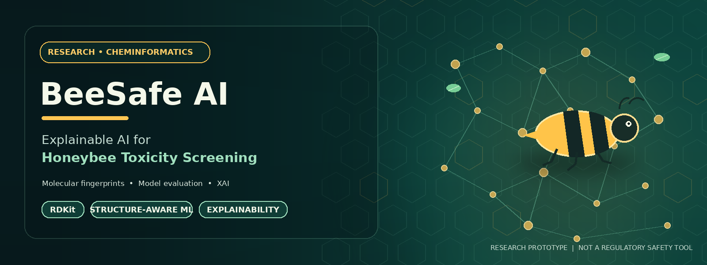
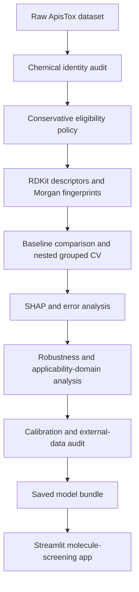

<p align="center">
  
</p>


# 🐝 BeeSafe AI
### Explainable and uncertainty-aware machine learning for honeybee pesticide-toxicity screening


**BeeSafe AI** is a research prototype that estimates the **dataset-defined binary acute honeybee-toxicity label** of a chemical from its molecular structure. It combines chemical-identity auditing, RDKit feature engineering, structure-grouped model evaluation, explainable AI, calibration diagnostics, chemical-similarity analysis, and an interactive Streamlit application.

> **Important:** This is a research screening tool, not a pesticide-registration system, regulatory safety assessment, or predictor of field-level ecological harm. Independent external validation has **not** been established.

## Contents

- [Overview](#overview)
- [Key features](#key-features)
- [Dataset and molecular features](#dataset-and-molecular-features)
- [Evaluation results](#evaluation-results)
- [Research workflow](#research-workflow)
- [Streamlit app](#streamlit-app)
- [Technology stack](#technology-stack)
- [Repository structure](#repository-structure)
- [Run locally](#run-locally)
- [Reproduce the research workflow](#reproduce-the-research-workflow)
- [Limitations and responsible use](#limitations-and-responsible-use)
- [Data provenance and license](#data-provenance-and-license)

## Overview

Chemical toxicity models can be overconfident when the data contain uncertain chemical identities, related structures across evaluation splits, or compounds unlike those used for training. BeeSafe AI is designed to make those risks more visible. The workflow preserves the raw dataset, records chemical-identity audit decisions, builds molecular features, evaluates models using structure-grouped validation, investigates errors and explanations, and checks calibration and chemical-space support.

### Project at a glance

| Item | Details |
|---|---|
| Prediction target | `label`: 0 = dataset-defined non-toxic; 1 = dataset-defined toxic |
| Raw dataset | 1,035 records |
| Baseline modelling set | 1,025 records; 10 identity-flagged records withheld |
| Molecular representation | 2,048-bit Morgan fingerprint, radius 2 |
| Additional descriptors | 12 RDKit molecular descriptors |
| Selected model family | Extra Trees using Morgan fingerprints |
| App model artifact | Phase 08 sigmoid-calibrated ensemble |
| Primary evaluation | Nested structure-grouped cross-validation |
| External validation | Not performed; eligible independent candidates were insufficient |

## Key features

- Chemical identity audit with repeated-identifier checks and PubChem verification support.
- Conservative data handling: flagged records are withheld from baseline modelling rather than silently corrected.
- Molecular features from RDKit: Morgan fingerprints and interpretable descriptors.
- Structure-grouped model comparison and nested cross-validation to reduce overly optimistic estimates from related compounds crossing folds.
- Optuna TPE hyperparameter search.
- SHAP global/local interpretation and false-positive/false-negative review.
- Maximum Tanimoto similarity to a reference compound, when reference files are available.
- Calibration, fold-stability, bootstrap, similarity-stratified, and selective-prediction diagnostics.
- Per-molecule JSON export from the Streamlit app.

## Dataset and molecular features

The project uses the ApisTox dataset's existing binary acute honeybee-toxicity label. It does not directly measure pesticide exposure, colony-level outcomes, or ecological damage.

The raw CSV contains **1,035 records**. Phase 02 flagged 10 records for chemical-identity review (4 high priority and 6 medium priority). Under the conservative Phase 03 policy, those records were withheld from the baseline modelling set:

| Baseline label | Dataset meaning | Records |
|---|---|---:|
| `0` | Dataset-defined non-toxic | 731 |
| `1` | Dataset-defined toxic | 294 |
| **Total** | | **1,025** |

The pipeline does not automatically rewrite the original identifiers, labels, or SMILES. A chemical database identity match is not, by itself, verification of a toxicity label.

### Molecular representation

The deployed model uses a **Morgan fingerprint (radius 2, 2,048 bits)**. The pipeline also calculates these 12 descriptors for analysis and display:

`MolWt`, `MolLogP`, `TPSA`, `NumHDonors`, `NumHAcceptors`, `RingCount`, `HeavyAtomCount`, `NumRotatableBonds`, `NumAromaticRings`, `FractionCSP3`, `FormalCharge`, and `NumHeteroatoms`.

The app validates and canonicalizes SMILES using RDKit. Canonicalization makes structure representation consistent; it does not establish experimental toxicity.

## Evaluation results

The primary model-selection estimate uses **nested structure-grouped cross-validation** with four outer folds and three inner folds. Hyperparameter selection takes place within each outer-training fold.

| Evaluation procedure | Metric | Result |
|---|---|---:|
| Phase 05 nested grouped CV | Mean Average Precision (AP) | **0.755 ± 0.088** |
| Phase 05 nested grouped CV | Mean ROC-AUC | **0.818 ± 0.071** |
| Phase 08 cross-fitted sigmoid-calibration diagnostic | Average Precision | 0.757 |
| Phase 08 cross-fitted sigmoid-calibration diagnostic | ROC-AUC | 0.825 |
| Phase 08 cross-fitted sigmoid-calibration diagnostic | Brier score | 0.126 |
| Phase 08 cross-fitted sigmoid-calibration diagnostic | 10-bin expected calibration error (ECE) | 0.061 |

**Interpretation:** Phase 05 results are the primary nested-CV estimates for the model-selection procedure. Phase 08 values are exploratory calibration diagnostics for a previously selected candidate and calibration workflow. These are different evaluation procedures, not one independent test result.

### External validation status

**Independent external validation has not been completed.** After exact canonical-structure overlaps were excluded, the Phase 08 audit found only 6 unique non-overlapping candidates for the contact endpoint and 2 for the oral endpoint, below the project's minimum of 30 per endpoint. Source independence and endpoint compatibility were also unverified. No external-validation performance metrics are claimed.

## Research workflow

The notebooks are designed to be run in order:

| Phase | Notebook | Main purpose |
|---|---|---|
| 01 | [Dataset exploration](notebooks/01_dataset_exploration.ipynb) | Inspect data structure, quality, labels, and molecular records. |
| 02 | [Chemical identity audit](notebooks/02_chemical_identity_audit.ipynb) | Audit identifiers and structures; record verification evidence and review priorities. |
| 03 | [Preprocessing and feature engineering](notebooks/03_data_preprocessing_and_feature_engineering.ipynb) | Verify source integrity; create descriptors, fingerprints, and structure groups. |
| 04 | [Baseline modelling](notebooks/04_baseline_model_training_and_evaluation.ipynb) | Compare initial classifiers with grouped CV and a structure-group-aware holdout. |
| 05 | [Optimization and nested CV](notebooks/05_advanced_optimization_and_nested_cv.ipynb) | Tune candidate models and estimate model-selection performance. |
| 06 | [Explainability and reliability](notebooks/06_explainable_ai_and_model_reliability.ipynb) | Inspect errors, SHAP explanations, similarity support, and tree-disagreement proxies. |
| 07 | [Robustness and uncertainty](notebooks/07_robustness_applicability_uncertainty_validation.ipynb) | Assess fold stability, group-bootstrap intervals, similarity strata, and selective prediction. |
| 08 | [Scientific validation and calibration](notebooks/08_scientific_validation_calibration_uncertainty.ipynb) | Compare calibration methods, build the app model bundle, and audit possible external data. |



Detailed outputs, figures, CSV tables, JSON summaries, and reproducibility manifests are stored under [`reports/`](reports/).

## Streamlit app

The interactive application is in [`app/`](app/) and is intended for exploratory one-molecule-at-a-time screening.

- **Molecule screening:** enter a SMILES string, validate the structure, inspect molecular properties, obtain a model probability, and view nearest-reference similarity when reference artifacts are available.
- **Research insights:** view available charts and summaries generated by the research workflow.
- **Model & methodology:** inspect model and methodological context.
- **Project status:** check the local model and supporting artifacts.

Depending on available artifacts, the app can show canonical SMILES, a molecular rendering, formula, molecular weight, 12 descriptors, the estimated probability of dataset label `1`, a threshold-based display category, nearest-reference similarity, a low-similarity warning, and a downloadable JSON summary.

The probability is an estimate for the dataset-defined label—not the probability of harm under real-world exposure. Changing the display threshold or similarity-warning cutoff changes the UI rule, not the trained model. The similarity cutoff is a heuristic, not a universally validated applicability-domain boundary. See [`app/README.md`](app/README.md) for application details.

## Technology stack

| Area | Tools |
|---|---|
| Language and UI | Python, Streamlit |
| Cheminformatics | RDKit |
| Data processing | NumPy, pandas |
| Machine learning | scikit-learn, joblib |
| Hyperparameter optimization | Optuna |
| Explainable AI | SHAP |
| Visualization | Matplotlib, Seaborn, Altair |
| Reproducibility | SHA-256 checksums, saved manifests, CSV/JSON reports |

## Repository structure

```text
.
├── app/                 # Streamlit interface and inference engine
├── data/
│   ├── raw/             # Source dataset and split files
│   └── processed/       # Processed features and metadata
├── models/              # Baseline, tuned, and calibrated model artifacts
├── notebooks/           # Research phases 01–08
├── reports/             # Evaluation tables, figures, summaries, manifests
├── packages.txt         # Linux system package for deployment
└── README.md
```

## Run locally

### 1. Clone the repository

```bash
git clone https://github.com/srabon-d-costa/BeeSafe-AI-Explainable-Pesticide-Toxicity-Prediction.git
cd BeeSafe-AI-Explainable-Pesticide-Toxicity-Prediction
```

### 2. Install app dependencies

Use a Python environment compatible with [`app/requirements.txt`](app/requirements.txt):

```bash
python -m pip install -r app/requirements.txt
```

The repository's `packages.txt` includes `libxrender1` for Linux deployment environments that need molecular rendering support.

### 3. Start Streamlit

Run this from the repository root:

```bash
python -m streamlit run app/app.py
```

Open the local URL printed in the terminal (commonly `http://localhost:8501`). The app looks for model artifacts under `models/` and reference data under `data/`.

If the project is moved or the app is launched from a different layout, set `BEESAFE_PROJECT_ROOT` to the repository root before starting Streamlit.

**PowerShell:**

```powershell
$env:BEESAFE_PROJECT_ROOT = "C:\path\to\BeeSafe-AI-Explainable-Pesticide-Toxicity-Prediction"
python -m streamlit run app/app.py
```

**Linux/macOS:**

```bash
export BEESAFE_PROJECT_ROOT="/path/to/BeeSafe-AI-Explainable-Pesticide-Toxicity-Prediction"
python -m streamlit run app/app.py
```

Only load trusted model artifacts generated by this project; do not load arbitrary user-uploaded `joblib` files.

## Reproduce the research workflow

1. Open the notebooks in Jupyter.
2. Run Phases 01–08 in order, ensuring each phase's expected outputs exist before proceeding.
3. Keep the raw CSV unchanged. If its checksum differs from the saved audit manifest, investigate and rerun the relevant earlier phases.
4. Inspect the reports and reproducibility manifest saved by each phase.
5. Phase 02's live PubChem verification requires internet access; the notebook documents an option for offline runs.

The notebooks include path defaults from the original Windows development environment and support `BEESAFE_PROJECT_ROOT` for relocation. The app requirements file is **not** a fully pinned environment lockfile for every research notebook.

## Limitations and responsible use

- **Dataset-defined endpoint:** the model predicts the label in the curated dataset. It does not predict dose, exposure, persistence, colony decline, pollination impacts, or ecosystem-level outcomes.
- **No independent external validation:** current external-data candidates did not meet the project's minimum sample and provenance requirements. Do not describe the model as externally validated.
- **Exploratory calibration:** calibration results do not prove that probabilities remain calibrated for novel chemistry or real-world outcomes.
- **Chemical-space limitations:** performance can deteriorate for structures dissimilar to the reference chemistry. Similarity is a warning signal, not a safety guarantee.
- **Uncertainty proxy:** variation among tree predictions is descriptive and is not a calibrated predictive interval.
- **Threshold dependence:** precision and recall change with the chosen threshold. No interface threshold is a regulatory or ecological safety boundary.
- **Human review required:** use predictions to prioritize further investigation, not to make pesticide-use, environmental-release, or regulatory decisions.

## Data provenance and license

The raw CSV contains the chemical records and source metadata used by the workflow. Before redistributing the dataset or using it in a publication, verify the original ApisTox source publication, attribution requirements, and data-licensing terms.

At the time this README was prepared, the repository did not contain a root `LICENSE` file. Do not assume that the absence of a license grants permission to reuse or redistribute the code or data. Add an appropriate project license and document the dataset's original terms before inviting reuse.

For academic work, cite this repository and the original dataset publication after its full bibliographic details and reuse terms have been confirmed.

---

*BeeSafe AI is a research prototype. Its value depends on transparent evaluation, careful interpretation, and additional independent validation.*
